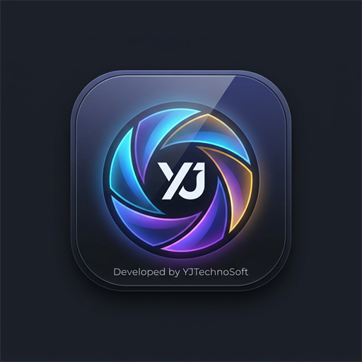
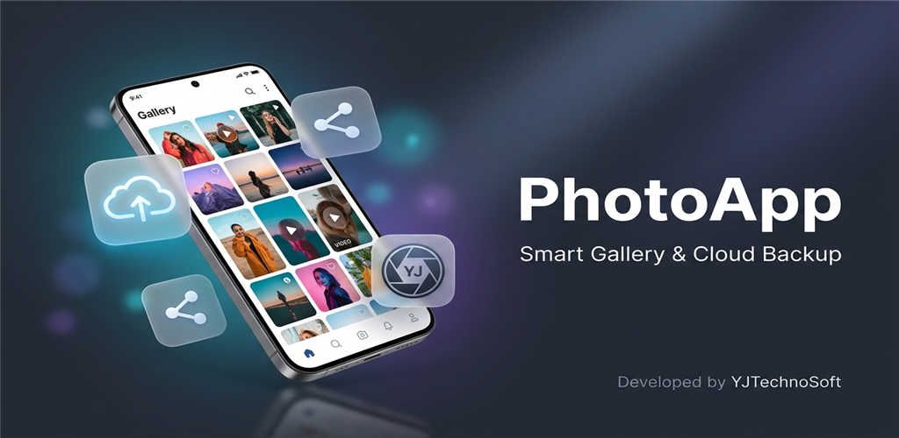
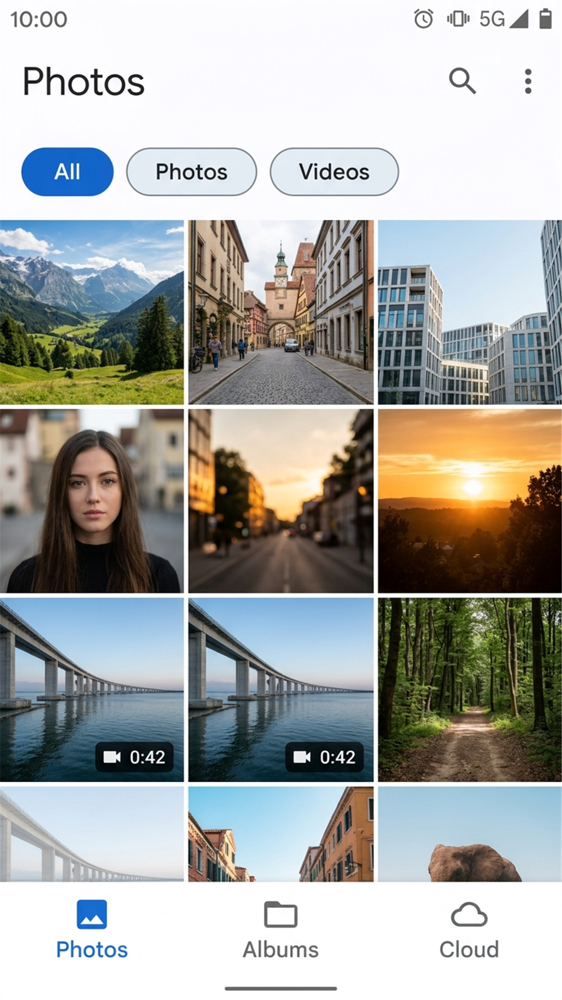
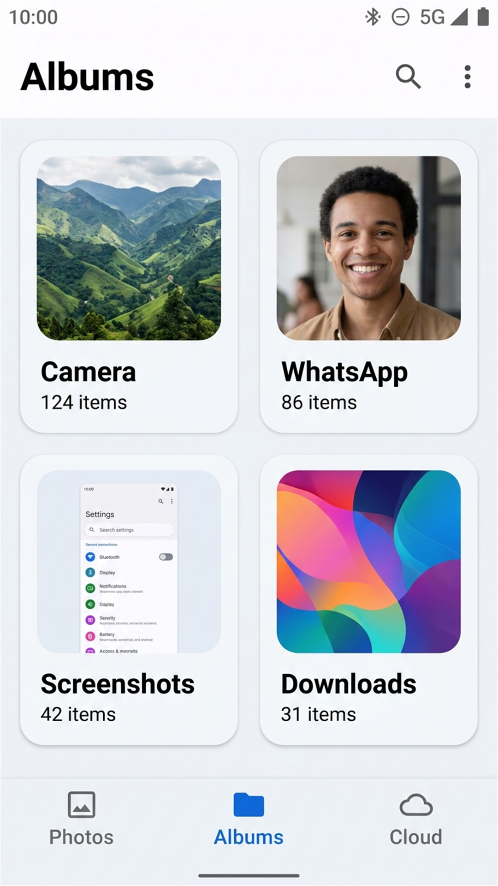
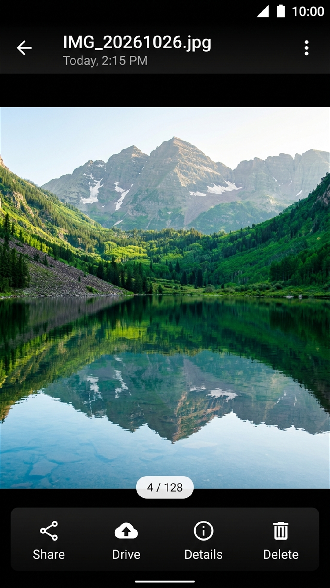
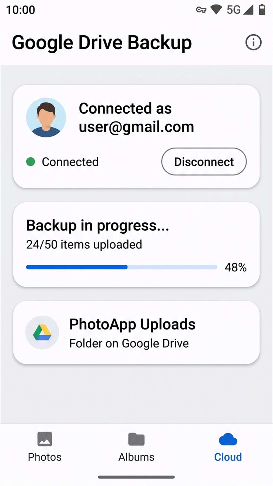

<div align="center">



# PhotoApp — Ad-Free Photo & Video Gallery
### *A Clean, Fast & Privacy-First Media Gallery for Android*

[](https://yjtechnosoft.com)
[](https://flutter.dev)
[](https://dart.dev)
[](LICENSE)
[](#)

<br/>



<p align="center">
  <strong>PhotoApp</strong> is a completely free and <strong>100% ad-free</strong> modern gallery application built with Flutter. It organizes all your local photos and videos into a fluid chronological timeline and folder albums, offers pinch-to-zoom photo viewing and native video playback, and provides optional, secure cloud backup to your personal Google Drive.
</p>

</div>

---

## 📱 App Previews & Screenshots

<div align="center">
<table>
  <tr>
    <td align="center" width="25%">
      <strong>📸 Timeline Gallery</strong><br/><br/>
      <br/><br/>
      <em>All photos & videos with All / Photos / Videos filters</em>
    </td>
    <td align="center" width="25%">
      <strong>📁 Folders & Albums</strong><br/><br/>
      <br/><br/>
      <em>Camera, WhatsApp, Screenshots & Downloads</em>
    </td>
    <td align="center" width="25%">
      <strong>🔍 HD Photo Viewer</strong><br/><br/>
      <br/><br/>
      <em>Full pinch-to-zoom, metadata info & direct share</em>
    </td>
    <td align="center" width="25%">
      <strong>☁️ Google Drive Backup</strong><br/><br/>
      <br/><br/>
      <em>One-tap Google Sign-In with real-time progress</em>
    </td>
  </tr>
</table>
</div>

---

## ✨ Features

- **🚫 100% Ad-Free & Tracker-Free**: Pure gallery experience. No intrusive pop-ups, banner advertisements, or background tracking.
- **🖼️ Unified Media Timeline**: Aggregates all on-device photos and videos with fast, memory-optimized thumbnail caching.
- **📂 Smart Directory Organization**: Automatically categorizes files into device folders with live item counts and folder cover thumbnails.
- **🎬 Built-In Video Player**: Plays local MP4/MKV video files with interactive playback scrubbers and duration overlays.
- **🔎 Pinch-To-Zoom Photo Viewer**: Inspect high-resolution photos with fluid pan and zoom gestures.
- **☁️ Google Drive Cloud Backup**: Connect your Google Account and upload individual or batch-selected media to a dedicated `PhotoApp Uploads` folder.
- **📤 Multi-Select & Share**: Long-press any photo or video to select multiple items for batch sharing across WhatsApp, Telegram, Email, or Bluetooth.
- **🌓 Dark & Light Modes**: Fully adaptive Material You themes designed for battery saving on AMOLED displays.

---

## 🛠️ Tech Stack & Architecture

- **Framework**: [Flutter](https://flutter.dev) (v3.47+)
- **Language**: [Dart](https://dart.dev) (v3.13+)
- **State Management**: [Provider](https://pub.dev/packages/provider)
- **Media Access**: [photo_manager](https://pub.dev/packages/photo_manager)
- **Interactive Viewer**: [photo_view](https://pub.dev/packages/photo_view)
- **Video Playback**: [video_player](https://pub.dev/packages/video_player)
- **Cloud Integration**: [google_sign_in](https://pub.dev/packages/google_sign_in), [googleapis](https://pub.dev/packages/googleapis) (Drive API v3)
- **Native Sharing**: [share_plus](https://pub.dev/packages/share_plus)

```text
Photo-app/
├── docs/assets/               # App logo, feature banner & UI screenshots
├── lib/
│   ├── models/                # MediaItem & AlbumModel data contracts
│   ├── providers/             # GalleryProvider & GoogleDriveProvider
│   ├── screens/               # HomeScreen, AlbumScreen & MediaViewerScreen
│   ├── services/              # MediaService, GoogleDriveService & ShareService
│   ├── utils/                 # Theme, DateUtils & styling
│   └── widgets/               # MediaThumbnail, AlbumCard, GoogleAccountWidget
└── store_listing/             # Google Play graphics, descriptions & privacy policy
```

---

## 🚀 Getting Started

### 1. Clone the repository
```bash
git clone https://github.com/yatindradhurwe/photo_app.git
cd photo_app
```

### 2. Install dependencies
```bash
flutter pub get
```

### 3. Run the application
```bash
flutter run
```

---

## 📦 Building for Production

### Android App Bundle (Google Play):
```bash
flutter build appbundle --release
```

### Universal APK:
```bash
flutter build apk --release
```

---

## 🔒 Permissions Policy

| Permission | Purpose |
| :--- | :--- |
| `READ_MEDIA_IMAGES` | Core gallery feature: to display photos in timeline and album folders |
| `READ_MEDIA_VIDEO` | Core gallery feature: to index and play videos |
| `READ_EXTERNAL_STORAGE` | Backward compatibility for Android 12 and below |
| `INTERNET` | Optional: strictly used when you choose to connect Google Drive to back up files |

---

## 📄 License

This project is licensed under the **MIT License** — completely open and free for anyone to use, modify, and build upon.

---

<div align="center">
  Developed with ❤️ by <strong><a href="https://yjtechnosoft.com">YJTechnoSoft</a></strong>
</div>
